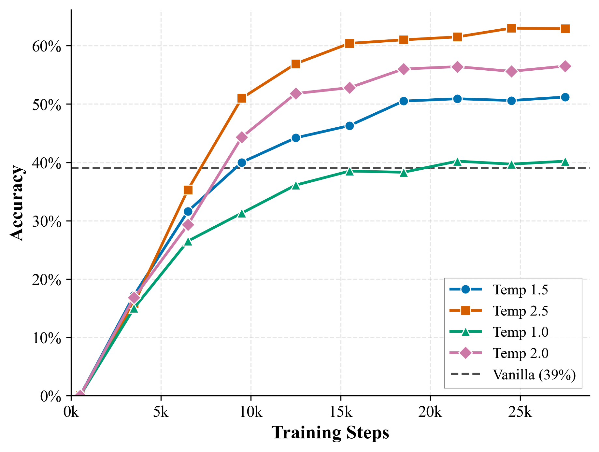

# Z-Sudoku

## 项目简介

本项目 "Z-Sudoku" 是我的期末大作业。它探索了基于 Diffusion 模型（MDM）的数独生成与求解任务，并引入了 Z-Mask 机制进行改进。项目包含了模型训练、评估以及一个可视化的 Gradio 演示程序。

## 环境配置

推荐使用 Conda 进行环境管理。本项目基于 Python 3.9+ 开发。

### 1. 创建并激活环境

建议创建一个新的 Conda 环境以避免依赖冲突：

```bash
# 创建名为 z-sudoku 的环境
conda create -n z-sudoku python=3.9 -y

# 激活环境
conda activate z-sudoku
```

*(如果您已有名为 `mdm` 的环境，也可以直接使用 `conda activate mdm`)*

### 2. 安装依赖

项目根目录下提供了 `requirements.txt` 文件，包含了运行所需的全部核心依赖（包括 PyTorch 2.x, Transformers, Accelerate, SwanLab, Gradio 等）。请确保在项目根目录下运行：

```bash
pip install -r requirements.txt
```

### 3. 配置说明

- **Accelerate**: 本项目使用 HuggingFace Accelerate 进行多卡训练。训练脚本中通过命令行参数指定了分布式配置。
- **实验记录**: 默认集成了 SwanLab 和 WandB。脚本中设置了 `WANDB_MODE=offline` 进行离线记录。如需在线同步，请在环境中配置相应的 API Key。

## 数据准备

训练和测试数据位于 `data/` 目录下：
- `data/sudoku_train.csv`: 训练数据集
- `data/sudoku_test.csv`: 测试数据集

## 模型训练

本项目提供了两种训练模式的脚本：Standard Vanilla Diffusion 和 Z-Mask Diffusion。

### 1. 训练 Vanilla 模型
运行以下脚本开始训练基础模型：
```bash
bash scripts/train-vanilla.sh
```
该脚本会将相应的输出保存到 `output/Vanilla/` 目录下。

### 2. 训练 Z-Mask 模型
运行以下脚本开始训练带有 Z-Mask 机制的模型：
```bash
bash scripts/train-zmask.sh
```
该脚本会将相应的输出保存到 `output/z-mask/` 目录下。

**注意**: 训练脚本默认使用多卡 (8卡) 并行训练，如需修改使用的 GPU 数量或编号，请编辑脚本中的 `devices` 变量和 `accelerate launch` 的参数。

## 实验结果

我们在数独生成任务上对比了 Z-Mask 方法与传统 Vanilla Diffusion 的性能。



如上图所示，在相同的训练步数下：
- **Vanilla Baseline**: 准确率停滞在 **39%** 左右（图中灰色虚线）。
- **Z-Mask**: 在不同温度参数（Temperature）设置下均取得了显著优于 Vanilla 的性能。
    - **Temp 2.5** (橙色曲线) 表现最佳，最终准确率达到 **63%** 以上。
    - **Temp 2.0** (粉色曲线) 次之，达到约 56%。
    - 即使是较低的温度设置 (Temp 1.0)，准确率也能稳定在 40% 左右，略高于 Baseline。

这证明了 Z-Mask 机制在数独求解/生成任务中的有效性。

## 运行演示 (Demo)

项目包含一个基于 Gradio 的交互式演示应用。

运行命令：
```bash
python demo/app.py
```
启动后，可以通过浏览器访问终端输出的 URL 进行体验。
*(注意：`demo/app.py` 中加载的模型路径可能需要根据您实际训练出的模型路径进行修改)*

## 文件结构说明

- `data/`: 存放数据集及数据生成脚本
- `demo/`: 存放 Gradio 演示代码
- `model_config_tiny/`: 预定义的模型配置文件
- `output/`: 训练产生的模型检查点和日志（训练后生成）
- `scripts/`: 训练脚本 (Shell scripts)
- `src/`: 核心源代码，包含模型定义、Trainer 实现及相关工具函数
    - `llmtuner/`: 核心微调与训练逻辑
    - `train_bash.py`: 训练入口文件
- `LICENSE`: 项目许可证
